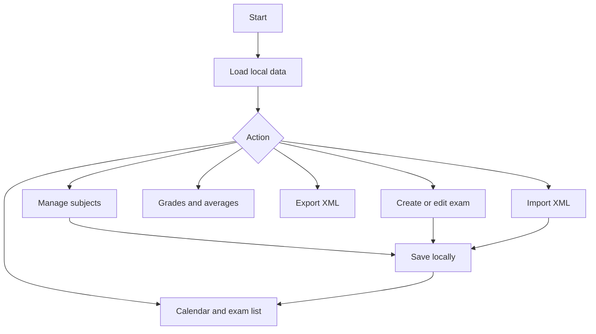
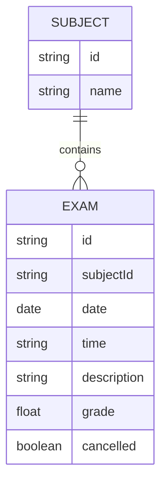

# User guide — Exam Manager

## Installation
Open the app over HTTPS on GitHub Pages. On Android, choose **Install app** in the browser menu or use the installation button when offered. Once cached, the PWA can work offline.

## Using the app
1. Open **Subjects** to add, rename, or remove subjects. A subject with associated exams cannot be deleted.
2. Click **New exam** and enter the subject, date, optional time, and description.
3. Browse the **Calendar** by day or use **Exams** to filter by subject and status.
4. After an exam, edit it to add an optional **grade from 0 to 10**.
5. Open **Grades** for all marks and the arithmetic average per subject. Ungraded exams are excluded.
6. Use **Export XML** to download a backup and **Import XML** to restore it. **Import replaces all existing local data**, so export first.
7. Switch languages with the **Español / English** selector.

**Upcoming** and **Completed** are determined by the local date; **Cancelled** is a manual setting. Today's exams remain upcoming.

## Storage and privacy
Data is stored in each browser's `localStorage` and does not automatically sync between devices. Clearing site data or using private browsing may erase records. Keep XML backups.

## Workflow (Mermaid)

## Data model

