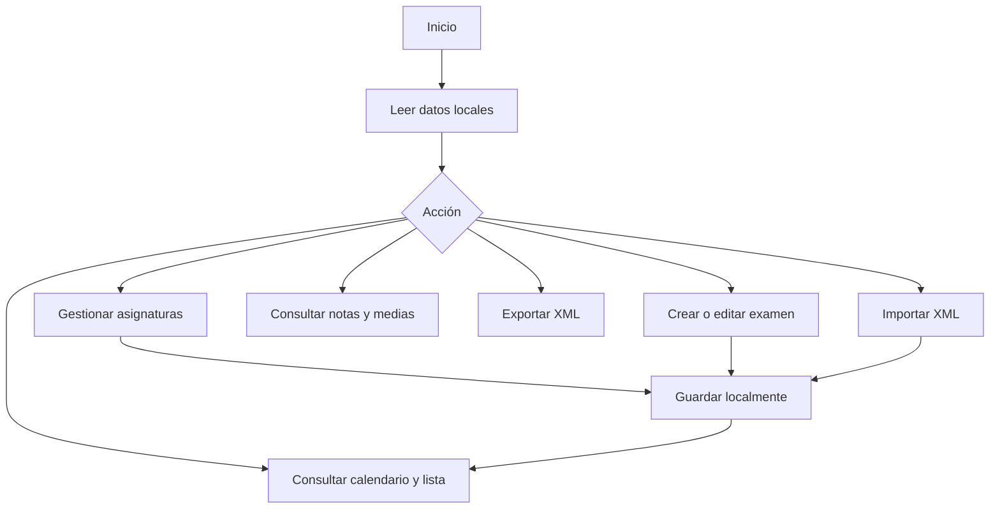
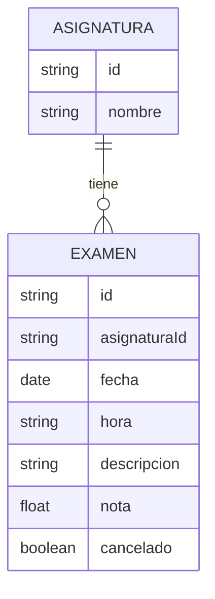

# Manual de usuario — Gestor de Exámenes

## Instalación
Abre la aplicación mediante HTTPS en GitHub Pages. En Android, usa **Instalar aplicación** en el menú del navegador o el botón de instalación cuando esté disponible. Una vez cargada por primera vez, la PWA puede funcionar sin conexión.

## Uso
1. En **Asignaturas**, añade, edita o elimina materias. No se puede eliminar una materia que tenga exámenes asociados.
2. Pulsa **Nuevo examen** y selecciona asignatura, fecha, hora opcional y descripción. Guarda.
3. Consulta **Calendario** para ver exámenes por día o **Exámenes** para filtrarlos por materia y estado.
4. Tras el examen, edítalo para añadir la **nota entre 0 y 10**. La nota es opcional.
5. En **Calificaciones**, consulta las notas y la media aritmética de cada asignatura; los exámenes sin nota no cuentan en la media.
6. Usa **Exportar XML** para descargar una copia y **Importar XML** para restaurarla. **Importar sustituye todos los datos actuales**, por lo que conviene exportarlos primero.
7. Cambia de idioma mediante el selector **Español / English**.

Los estados **Pendiente** y **Realizado** se calculan según la fecha local; **Cancelado** se establece manualmente. Un examen del día actual sigue figurando como pendiente.

## Privacidad y almacenamiento
Los datos se almacenan en `localStorage` de cada navegador, sin sincronización entre dispositivos. Borrar datos del sitio o navegar en modo privado puede hacerlos desaparecer. Guarda copias XML periódicas.

## Diagrama de funcionamiento (Mermaid)

## Modelo de datos

